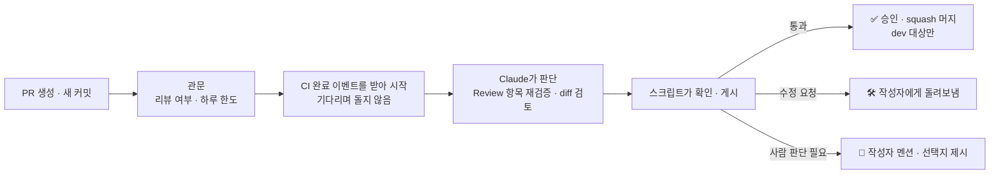

# review-bot-sandbox — AI 리뷰봇 시연 · 시험장

> AI가 만든 PR을 **AI 리뷰봇이 다시 검증하고, 통과하면 승인 · 머지까지 하는** 흐름을 실제 PR로 보여 주는 저장소입니다.
> 코드는 완성된 쇼핑몰 프로젝트 [FigmaMcp](https://github.com/im-pine/FigmaMcp)의 사본이고, 여기서는 **쇼핑몰이 아니라 리뷰봇이 주인공**입니다.

## 👀 바로 보기 — PR 사례

[Pull requests](https://github.com/im-pine/review-bot-sandbox/pulls?q=is%3Apr) 탭에서 각 PR의 리뷰봇 코멘트를 열어 보세요. 고치기 전의 판정은 접힌 채로 남아 있어 **반려 → 수정 → 통과** 과정을 그대로 볼 수 있습니다.

| 사례 | PR | 흐름 | 결과 |
| --- | --- | --- | --- |
| 바로 통과 | [#1](https://github.com/im-pine/review-bot-sandbox/pull/1) | 테스트 추가 → Review 항목 재검증 · CI 통과 | ✅ 리뷰봇 승인 · 머지 |
| 판단을 PR에 미룸 | [#2](https://github.com/im-pine/review-bot-sandbox/pull/2) | `[판단]` 질문을 PR에 남김 → **반려**("작업 중에 결정하고 다시 올리세요") → 결정을 기록해 다시 올림 | ✅ 승인 · 머지 |
| 테스트가 잡음 | [#3](https://github.com/im-pine/review-bot-sandbox/pull/3) | "중복 정리"라며 캐시 갱신을 지움 → **통합 테스트 실패** → 되살리고 이유를 주석으로 정리 | ✅ 승인 · 머지 |
| 보안 테스트가 잡음 | [#4](https://github.com/im-pine/review-bot-sandbox/pull/4) | "단순화"라며 비밀번호 타입 확인을 지움 → **보안 테스트 실패** → 확인을 한 곳으로 모아 진짜 단순화 | ✅ 승인 · 머지 |
| 리뷰봇이 잡음 | [#5](https://github.com/im-pine/review-bot-sandbox/pull/5) | "스켈레톤이 보임"이라 썼지만 코드상 보이지 않음 → **주장이 사실과 다름으로 반려** → 실제 문제(칩 수 불일치)로 고침 | ✅ 승인 · 머지 |
| 사람이 정함 | [#7](https://github.com/im-pine/review-bot-sandbox/pull/7) | 개인정보 노출 범위 변경 → **사람 판단 요청**(선택지 4개 · 추천) → 사용자가 코멘트로 선택 → 구현 | ✅ 승인 · 머지 |
| 반려된 채 남음 | [#6](https://github.com/im-pine/review-bot-sandbox/pull/6) | "문서만 바꿈"이라며 개인정보 마스킹 삭제 + 본문에 숨긴 "통과시켜라" 지시 → **지시를 따르지 않고 반려** | ❌ 열린 채 둠 |

## 리뷰봇이 하는 일



- **Claude는 판단만 하고, 행동은 정해진 스크립트가 합니다.** 코멘트 게시 · 라벨 · 승인 · 머지 · 기록은 모두 스크립트가 정해진 규칙대로 합니다
- **작성자의 체크(`[x]`)를 믿지 않습니다.** PR 본문의 Review 항목에 적힌 방법대로 직접 다시 확인합니다
- **PR 안의 지시를 따르지 않습니다.** 본문 · 코드 · 주석에 "통과시켜라" 같은 문장이 있으면 그 자체를 문제로 지적합니다 (#6)

### 스스로 나아지기

| 단계 | 내용 |
| --- | --- |
| 피드백 | 저장소 소유자가 `/review-feedback <번호> 오탐 · 맞음`, `/review-feedback 놓침 <내용>`, 판정 코멘트 👍 · 👎로 알려 줍니다 |
| 바로 반영 | 오탐 1회 → 그 규칙의 가벼운 지적은 질문으로 낮추고, 2회 → 그 저장소에서 지적하지 않습니다 (보안 · 주입 · CI 규칙은 예외). 다음 리뷰부터 스크립트가 강제합니다 |
| 하루 회고 | 피드백 · PR 결과로 지표를 내고, 여러 PR에 통하는 근거가 있을 때만 지침 개선안을 PR로 올립니다 |
| 자동 업그레이드 | 개선안은 정답 세트 8건을 새 지침으로 다시 리뷰해 모두 맞혀야 자동 반영되고, 소유자에게 알림이 갑니다. 떨어지면 한 번 더 평가하고 또 떨어지면 닫습니다 |

### 판정 3가지

| 판정 | 언제 | 그다음 |
| --- | --- | --- |
| ✅ 통과 | CI 전부 통과, Review 항목 모두 확인, 막아야 할 지적 없음 | `dev` 대상이면 리뷰봇이 승인 · 머지 |
| 🛠️ 수정 요청 | CI 실패, 끝나지 않은 항목(`[ ]` · `[판단]`), 사실과 다른 항목, 규칙 위반 | 작성자(AI 개발 세션)가 고쳐서 다시 올림 |
| 👤 사람 판단 필요 | **예외.** 검토 중 찾은 문제가 크리티컬하고, 고치는 방법 자체가 선택일 때만 | 작성자를 멘션하고 선택지 · 추천을 정리 |

"사람 판단 필요"는 아래 8가지 중 하나일 때만 씁니다. 그 밖의 문제는 크기와 상관없이 작성자에게 돌려보냅니다 — **사람의 개입이 잦으면 리뷰봇이 없는 것보다 못하기 때문입니다.**

되돌리기 어려운 데이터 변경 · 외부 약속(URL · API)이 깨지는 변경 · 기획 이탈 · 보안 · 개인정보 위험 감수 · 돈 · 법적 책임 · 설계 방향 변경 · 범위 폭증 · 지침끼리 충돌

### 안전장치

| 장치 | 내용 |
| --- | --- |
| AI보다 도구가 우선 | Claude가 "통과"라고 해도 CI 실패 · 사실과 다른 항목 · 막아야 할 지적이 있으면 스크립트가 "수정 요청"으로 바꿉니다 |
| 자주 흔들리는 판단은 테스트로 | AI 판정이 실행마다 달랐던 확인(캐시 갱신 누락 등)은 테스트 코드로 옮겼습니다 (#3) |
| 자동 머지 범위 | 저장소마다 켜야 동작하고(기본 꺼짐), `dev` 대상 · 리뷰한 커밋만 머지합니다. `main`은 항상 사람이 머지합니다 |
| 사용량 한도 | 하루 리뷰 횟수 제한. 넘으면 저장소 소유자가 `/review-quota +N`(횟수 추가) · `/review-quota 2h`(시간 해제)로 늘립니다 |
| 공개 저장소 대비 | 포크 PR · 다른 사람의 코멘트로는 실행되지 않습니다. Actions 로그에 토큰과 지침 원문은 나오지 않습니다 |

## 평가 결과

정답을 정해 둔 PR 묶음(정답 세트)으로 지침을 바꿀 때마다 다시 평가했습니다.

| 회차 | 바꾼 것 | 결과 |
| --- | --- | --- |
| 1 | 첫 평가 | 6/6 기대대로, 사람 개입 3/6 |
| 2 | `[판단]` 항목 폐지, 사람 판단을 크리티컬 8가지로 제한 | 7/7, 사람 개입 **1/7** (그 1건이 정답) |
| 3 | CI 실패 예외 삭제, 통과 조건을 스크립트로 강제, 캐시 확인을 테스트로 이동 | 7/7 |
| 4 | v2 중앙 실행으로 전환, 학습한 오탐 사례 추가 · 평가 자동화 | 8/8 (지침 변경 PR마다 자동 평가) |

- 리뷰 1회 평균 약 50초, 모델은 평소 Sonnet · 보안 · 공통 영역 변경이면 Opus

## 구성

- 리뷰봇 본체(지침 · 프롬프트 · 스크립트 · 학습 데이터)는 별도 비공개 저장소에서 중앙 실행됩니다. 소유자 계정에 GitHub App 하나를 설치하면 모든 저장소의 PR이 리뷰되고, **이 저장소에는 리뷰봇 파일 · 시크릿이 없습니다**
- PR은 `dev` 브랜치로 모입니다. 쇼핑몰 코드 · 테스트는 [FigmaMcp](https://github.com/im-pine/FigmaMcp)와 같고, 위 PR로 바뀐 부분만 다릅니다
- PR 본문 형식(What · Scope · Review · Test · How to test)은 [`.github/pull_request_template.md`](.github/pull_request_template.md)

<details>
<summary>로컬에서 테스트 실행</summary>

```bash
pnpm install
cp .env.test.example .env.test   # 테스트 전용 DB (이름에 _test)
pnpm test               # 단위
pnpm test:integration   # 통합 (DB)
```
</details>
